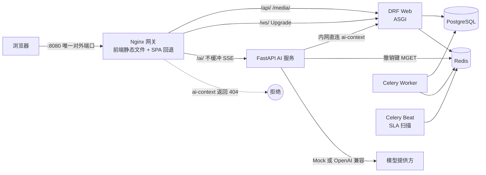

# TicketFlow AI

TicketFlow AI 是一个面向企业内部支持团队的工单与知识库协作平台：提交人建单，客服接单处理，AI 帮客服分析工单、起草回复，
解决的问题可以一键沉淀为知识库文章。底座是 [xadmin-server](https://github.com/nineaiyu/xadmin-server)（Django / DRF）
和 [xadmin-client](https://github.com/nineaiyu/xadmin-client)（Vue 3 / Element Plus），AI 能力是独立的 FastAPI 异步服务。

| 目录 | 内容 |
| --- | --- |
| [backend-drf](backend-drf/) | Django / DRF 业务、权限、Celery 任务和后端测试 |
| [service-fastapi](service-fastapi/) | 异步 AI 服务：工单分析、流式回复建议、与 DRF 联合鉴权 |
| [frontend](frontend/) | 工单列表、详情与 AI 面板、知识库、看板 |
| [deploy](deploy/) | 一条命令起全栈的 Compose、Nginx 网关、初始化与演示数据 |
| [tests](tests/) | 针对运行中网关的黑盒验收与 Locust 压测 |
| [docs/development](docs/development/) | 开发计划书、各迭代验收说明、压测报告 |

实现基线是 [Phase 1 设计评审](backend-drf/docs/plans/ticketflow-phase-1.md)，接口契约、数据范围和阶段边界以它为准。

## 架构



- 网关是唯一发布宿主端口的服务，其余容器只在 Compose 内网通信。
- DRF 与 FastAPI 共用一个 `JWT_SIGNING_KEY`，FastAPI 自己校验 access token 并读取 DRF 写入 Redis 的撤销标记，不回调 DRF 验权。
- FastAPI 需要工单内容时走内网直连 DRF 的 `ai-context` 接口，DRF 按当前用户重新判定可见性；这个接口不经网关对外。
- Celery Beat 每分钟扫描 SLA，Worker 负责导出、通知等异步任务。

## 快速开始

需要 Docker Desktop（或 Linux 上的 Docker Engine）、Docker Compose v2 和宿主机 Python 3。在仓库根目录执行：

```powershell
python deploy/local.py env
docker compose -f deploy/docker-compose.yml --env-file deploy/.env up -d --build
python deploy/local.py seed
```

打开 `http://127.0.0.1:8080`，演示账号的口令在 Git 忽略的 `deploy/.accounts.local.json`。`tf_requester` 是提交人，
`tf_agent` 是客服（看得到 AI 面板），`tf_agent_other` 是另一个部门的客服，`tf_admin` 是业务管理员。

前置条件、日志、停止与清理、升级、常见故障都在 [deploy/README.md](deploy/README.md)。验收与冒烟：

```powershell
cd tests; uv sync --locked; uv run --locked pytest -q -s   # 网关黑盒验收，见 tests/README.md
cd frontend; npx -y pnpm@11 test:e2e:ticketflow             # 浏览器主流程冒烟，需 pnpm install 与 Chromium
```

开发环境（热重载的后端、前端 dev server）分别见 [backend-drf/AGENTS.md](backend-drf/AGENTS.md) 和 [frontend/AGENTS.md](frontend/AGENTS.md)。

## 技术要点

### 工单并发流转与建单幂等

- 状态流转在事务里先对工单加行锁，再比对客户端带来的版本号。版本落后返回 409，前端提示刷新后重试，不会覆盖别人的操作。
  状态、版本号和审计日志在同一个事务里提交。
- 建单接受幂等键。Redis 记录短时占位和完成结果，PostgreSQL 唯一约束兜底，Redis 丢数据或并发撞车时仍然只建一张单，
  调用方用同一个键重试拿到的是同一张单。
- SLA 告警用工单、SLA 轮次和告警类型做唯一约束，Beat 重复触发不会重复告警；工单重新打开时开始新一轮 SLA。

### 联合鉴权

- FastAPI 固定校验 `HS256`、`aud`、`iss`、`exp`、`iat`、`token_type=access`，拒绝 refresh token。
- 登出、管理员踢下线、改密码在 DRF 侧写入 Redis 撤销键（单个 token、用户级时间戳、会话级）。FastAPI 每个请求一次 `MGET`
  读三个键，撤销立即生效；Redis 不可用时返回 503，不会把“读不到”当成“未撤销”。
- 授权仍以 DRF 为准：分析和回复每次都经 `ai-context` 取工单，DRF 按当前用户判断能不能看、能不能处理，结果缓存也绑定用户。

### 看得见的流式回复

- 回复建议走 SSE，帧序 `meta → (ping)* → delta+ → done`，失败以 `error` 帧收尾并标明能否重试。
- 网关对 `/ai/` 关闭缓冲、缓存和 gzip，`proxy_read_timeout` 大于心跳间隔，所以首段正文到达浏览器的时间远早于流结束，
  网关验收里有断言。
- 客户端断开时服务端关闭上游请求并释放模型并发槽位；前端换工单、关闭抽屉、重新生成都会取消在途的流。

### 查询优化与压测

- 列表与详情用 `select_related` / 预取一次带出提交人、处理人、部门和可见的日志评论，数据范围统一在 QuerySet 上限制。
- 看板统计走缓存。

压测经网关进行，5,000 张工单，8 个并发用户，DRF 单 worker，与故意去掉关联查询和预取的 N+1 档对比：

| 场景 | RPS | P95 (ms) | 视图 SQL 数 |
| --- | ---: | ---: | ---: |
| 列表 N+1 → 优化 | 16.44 → 37.24 | 590 → 310 | 62 → 6 |
| 详情 N+1 → 优化 | 32.24 → 37.86 | 300 → 260 | 26 → 12 |
| 看板冷缓存 → 热缓存 | 48.01 → 64.02 | 200 → 150 | 10–12 → 5 |

AI 服务用固定延迟的 Mock 模型、4 个上游槽位：12 个用户做分析时吞吐从 2 个用户的 5.17 升到 11.25 RPS，代价是排队 P95 680 ms；
流式请求超过槽位且排队超过 1 秒时返回 `503 UPSTREAM_BUSY`，不会无限堆积。四路流在客户端断开后，11 ms 内的首次采样里槽位已全部释放。
这些数字来自同机、短窗口、Mock 延迟，真实模型和长时间生产流量没有测过。完整数据、命令和结论见 [压测报告](docs/development/压测报告.md)。

## 多代理协作

项目由三个 AI 代理按角色分工开发，用户做最终决策：

| 角色 | 代理 | 负责 |
| --- | --- | --- |
| 总指导 + 前端 | Claude Code | 拆分任务、写任务书、定契约边界，开发 `frontend/`，集成与验收 |
| 后端 + 测试 | Codex | `backend-drf/`、`service-fastapi/`、`deploy/`、`tests/` 的实现与测试 |
| 评审 | Gemini（Antigravity） | 按评审清单只读评审每个任务分支，给出 APPROVE 或 REQUEST_CHANGES |

每个任务一个分支，执行者写完成报告（命令、原样输出、没验证的部分），评审通过后合入迭代集成分支，验收后由用户确认合并到 `main`。
Claude 用命令行直接调度另外两个代理，`collab/dashboard/` 是本机的 3D 指挥台，实时显示各代理状态、任务流水线和 Git 提交。
约定与流程见 [collab/README.md](collab/README.md)，各迭代的交付清单与验收记录见 [docs/development](docs/development/)。

## 许可

底座来自 xadmin-server 与 xadmin-client，上游许可证保留在各组件目录。
