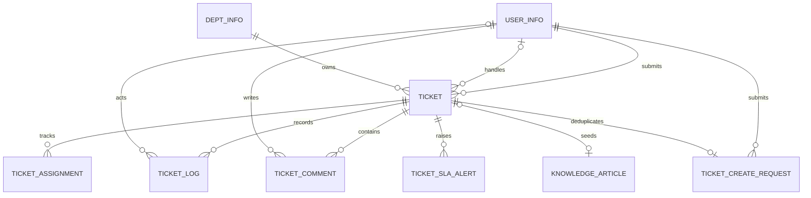
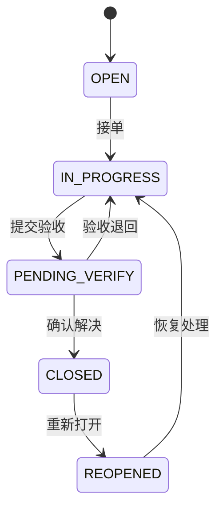

# TicketFlow AI Phase 1 设计评审

## 基线与 Monorepo 布局

后端基线为当前工作树的 `cda57221`，版本标记为 `5.0.2`。前端从 [xadmin-client v5.0.2](https://github.com/nineaiyu/xadmin-client/tree/v5.0.2) 导入，提交为 `4e8c2e79b0b96ceb6efc59d7edf8cd684aeeff4f`。前端源码由同一个 Monorepo 管理，并保留上游许可证。

```text
ticketflow-ai/
├── backend-drf/       # 现有 xadmin-server 工作树、内核包与后端测试
├── service-fastapi/   # 独立依赖锁和镜像，api / core / schemas / services
├── frontend/          # 已导入的 xadmin-client
├── deploy/            # Docker Compose 和 Nginx 入口
└── tests/             # 网关验收与 Locust
```

设计确认后，Phase 2 先将后端源码及现有 `tests/` 移入 `backend-drf/`，在同一 Git 历史中完成迁移。仓库入口和 GitHub Actions 留在根目录。迁移同时核对 Docker 构建上下文、工作流命令和触发路径、内核 uv workspace、前端契约脚本的 `XADMIN_SERVER_DIR`。根目录的 `tests/` 在 Phase 5 用于跨服务验收。

对外只发布 Nginx 端口。`/api/` 原样转发到 DRF，`/ai/` 原样转发到 FastAPI，`/` 转发到前端静态站点。现有 `/ws/` 转发到 DRF 的 ASGI 入口，保留底座的通知等 WebSocket 功能。DRF 的原生 AI 路由位于 `/api/ai/`。Nginx 对 `/ai/` 使用 HTTP/1.1，关闭响应缓冲、缓存和 gzip，读取超时大于心跳间隔。PostgreSQL、Redis、DRF 及 FastAPI 通过 Compose 内网互通。Web、Celery worker 和 Beat 使用同一后端构建产物。

## 工单与知识库



业务主键采用 UUID，审计字段沿用 `DbAuditModel`，用户和部门复用 `identity.UserInfo`、`identity.DeptInfo`。分类使用独立的业务字典编码，优先级固定为 `P0`、`P1`、`P2`、`P3`。接口日期统一输出带时区的 ISO 8601 时间。

| 表 | 字段与约束 |
| --- | --- |
| `Ticket` | `id`，唯一且服务端生成的 `number`，`title`（最长 200 字符），`description`，`category`，`priority`，`status`，`submitter_id`，可空 `assignee_id`，`department_id`，`sla_due_at`，`sla_cycle`（从 1 开始），可空 `first_response_at` / `resolved_at`，`ai_summary`，`ai_tags`（字符串数组），`version`（从 1 开始）。 |
| `TicketLog` | `ticket_id`，`action`，可空 `from_status`，`to_status`，`operator_id`（系统操作为空），`note`，`created_time`。按时间和 ID 稳定排序。 |
| `TicketAssignment` | `ticket_id`、`assignee_id`、可空 `assigned_by_id`、`started_at`、`ended_at`、`end_reason`、`note`。每张工单最多一段开放的指派记录。 |
| `TicketComment` | `ticket_id`，`author_id`，`body`，`visibility`（`PUBLIC` 对外回复 / `INTERNAL` 内部备注），`created_time`。 |
| `KnowledgeArticle` | `title`，`body_markdown`，`category`，`tags`（字符串数组），`status`（`DRAFT` / `PUBLISHED` / `ARCHIVED`），`view_count`（非负整数），可空 `source_ticket_id`（每个来源工单最多一篇），`created_time` / `updated_time`。 |
| `TicketCreateRequest` | `submitter_id`，`key_hash`，`request_hash`，`ticket_id`，`expires_at`。唯一约束 `(submitter_id, key_hash)`，与创建工单同事务写入。 |
| `TicketSlaAlert` | `ticket_id`，`sla_cycle`，`kind`（`DUE_SOON` / `OVERDUE`），`sla_due_at`，`created_time`。唯一约束 `(ticket_id, sla_cycle, kind)`。 |

### 状态与并发



以进入 `PENDING_VERIFY` 的时间作为 `resolved_at`。验收退回清空 `resolved_at`，继续使用本轮 SLA。重开清空 `resolved_at`、递增 `sla_cycle`。每轮截止时间按该轮开始时的优先级计算。首次响应以第一条客服对外回复为准，保留整单首次响应时间。建单时由服务端按分类路由到部门，无配置时走默认支持部门。

指派、流转、采纳 AI 建议必须提交读取时的 `version`。Service 在 `atomic()` 内对当前可见的主记录加 `select_for_update()`，比较版本、验证动作和角色，更新记录、递增版本并追加日志。版本过期或当前状态不允许该动作时返回 409。对外回复在事务内首次写入 `first_response_at`，只追加的评论无需提交版本。

### 角色与可见范围

角色、技能组和派单规则见[迭代 6 角色改造方案](../../../docs/development/迭代6角色改造方案.md)。

| 身份 | 工单范围 | 动作 |
| --- | --- | --- |
| 普通员工 | 本人提交 | 建单、查阅、对外回复、验收确认、验收退回、重开 |
| 技术员 | 当前指派、曾指派及本人提交 | 当前可接单、回复、写内部备注、提交验收、退回重派和使用 AI。历史工单提供完整时间线，处理人动作关闭。本人提交的历史工单仍可对外回复、验收确认、验收退回和重开。 |
| 管理员 | 全部，含待分配 | 处理、指派、知识库编辑与发布、导出，仍经状态机校验 |

API 动作复用底座 RBAC 和字段权限。列表、详情、时间线、看板、导出以及 AI 上下文统一应用工单可见范围。仅以提交人身份查看工单时只显示对外内容。技术员可通过知识库创建接口将经手过的已关闭工单转为草稿，每张工单最多转存一次。已发布文章对已登录用户开放，草稿对作者及管理员开放，归档对管理员开放。管理员负责审阅发布。

### 查询、缓存和后台任务

- 工单列表通过 `select_related` 获取提交人、处理人和部门。详情只预取当前用户可见的日志和评论，时间线超过一页时独立分页。首批索引包括 `(status, priority, sla_due_at)`、`(assignee_id, status)`、`(department_id, status)`、`(submitter_id, created_time)`。用固定数据量的查询计数和 PostgreSQL `EXPLAIN (ANALYZE, BUFFERS)` 验证。
- 建单要求 `Idempotency-Key`。Redis 按用户与键做原子占位和完成结果缓存，请求体用规范化摘要绑定。重放相同请求返回原工单，重复键的不同请求返回 409。Redis 锁过期、数据丢失或提交后缓存写失败时，以 PostgreSQL 唯一约束及原事务记录恢复。保留期建议 24 小时，占位仅在校验持有者后释放。
- 建单、评论与 AI 入口按用户和动作分桶，用 Redis 有序集合与 Lua 原子实现滑动窗口，超限返回 429 与 `Retry-After`。Redis 故障返回 503，避免限流被绕过。工单看板按用户、当前范围与筛选项缓存，工单写入提交后推进缓存代数。文章缓存按 ID 保存展示字段，写入提交后清除。详情先校验可见状态，只有已发布文章的详情访问使用数据库原子递增浏览数。缓存故障时看板和文章读取回源。
- Celery Beat 按分钟扫描未解决工单，临近截止及超时分别落结构化告警表。重复扫描或重试由唯一约束防重。Webhook 后续可接入已有投递机制。
- 异步导出沿用 `export-async` 和 `ExportRecord`。任务执行时按提交者当前权限重放筛选，分批遍历 QuerySet，首版输出 CSV，边生成边写临时文件再持久化。通过底座下载中心取状态和受权限控制的下载链接。

## API 契约

DRF 使用底座无尾斜杠路由、`ApiResponse` 信封和 `code=1000` 成功码，工单和文章资源主键沿用 xadmin 的 `pk`，分页数据为 `{total, results}`，分页参数为 `page` 和 `size`。业务错误使用非成功码及字符串 `detail`，并返回对应 HTTP 状态码。前端用 `pnpm sync:contract` 同步元数据镜像。

| 接口 | 请求 | 成功响应 |
| --- | --- | --- |
| `GET /api/tickets` | `status`、`priority`、`category`、`assignee_id`、`department_id`、`assignment`、`sla`、`q`、分页 | 200，工单分页，含 `version` 和 `sla_state` |
| `POST /api/tickets` | `Idempotency-Key`，`{title, description, category, priority}` | 201，创建的工单。重放返回 200 和原工单 |
| `GET /api/tickets/{id}` | 工单 ID | 200，工单、`viewer: {can_handle, can_assign, can_reply, can_comment_internal, can_archive, can_return, read_only}`、可执行流转、时间线第一页 |
| `GET /api/tickets/{id}/timeline` | 分页 | 200，合并排序的流转记录与评论分页 |
| `POST /api/tickets/{id}/transition` | `{target_status, version, note?}` | 200，更新后的工单 |
| `POST /api/tickets/{id}/assign` | `{assignee_id, version}` | 200，更新后的工单。已关闭工单返回 409 |
| `GET /api/tickets/{id}/assignees` | 管理员可传 `q` 搜索用户名或昵称、`department_id` 筛选技能组。空值忽略，非法 UUID 返回 400 | 200，最多 20 条在职技术员 `{pk, username, nickname, department_name}`，按用户名和主键排序 |
| `POST /api/tickets/{id}/return` | `{version, reason}`，原因长度 1–500 | 200，清空处理人、状态不变、版本递增 |
| `POST /api/tickets/{id}/comments` | `{body, visibility}` | 201，新评论 |
| `POST /api/tickets/{id}/ai-metadata` | `{version, summary, tags, category?, priority?}` | 200，采纳建议后的工单 |
| `GET /api/tickets/dashboard` | 与列表共用筛选 | 200，按状态、优先级及 SLA 分组计数，`assignment` 按当前身份返回待分配或当前与历史计数 |
| `POST /api/tickets/export-async` | 列表筛选字段加 `type: "csv"` | 200，`{record_id, task_id}`，完成后通过 `/api/task/exports/{record_id}/download` 下载 |
| `GET /api/knowledge/articles` | `q`、`category`、`tag`、`status`、分页 | 200，`data: {total, results, can_create_standalone}`，独立创建要求管理员及知识库创建权限 |
| `GET /api/knowledge/articles/{id}` | 文章 ID | 200，文章正文、浏览次数及 `viewer: {can_edit, can_publish}` |
| `POST /api/knowledge/articles` | `{title, body_markdown, category, tags, source_ticket_id?}` | 201，文章草稿 |
| `PATCH /api/knowledge/articles/{id}` | 可编辑内容或状态 | 200，更新后的文章 |
| `GET /api/tickets/{id}/ai-context` | 内网接口，转发用户 Bearer token | 200，授权工单字段及已发布知识 Top-K 片段。网关拒绝该路径 |

工单可见范围外返回 404，可见但缺少动作权限返回 403。契约校验失败返回 400，状态或版本冲突返回 409。Top-K 默认 5，按工单标题、描述和分类在 DRF 中检索，使用 PostgreSQL 关键词排序并为中文子串提供匹配。片段包含 `article_id`、`title` 和有长度上限的 `excerpt`。模型输入只包含当前用户获准的工单文本和知识片段。

历史技术员的 `viewer.read_only` 为 `true`。本人提交时，`can_reply` 和 `available_transitions` 仍反映提交人的能力。管理员或经手过该工单的技术员可用 `viewer.can_archive` 判断是否能将已关闭工单转存为草稿。

| FastAPI 接口 | 请求 | 成功响应 |
| --- | --- | --- |
| `POST /ai/v1/tickets/analyze` | `{ticket_id: UUID}` | 200，`{ticket_id, ticket_version, category, suggested_priority, summary, tags}`，Pydantic v2 校验类别、优先级和长度 |
| `POST /ai/v1/tickets/suggest-reply/stream` | `{ticket_id: UUID}` | 200，`text/event-stream`，可取消 |
| `GET /ai/v1/health` | 无需 token | 200，`{status: "ok", redis: "ok"}`。Redis 不通返回 503 |

FastAPI 建流前的错误响应统一为 `{code, error, detail}`。`code` 是与 HTTP 状态码一致的整数，`error` 是机器可读标识，`detail` 是可读说明。401 表示令牌失效，403 / 404 对应 DRF 资源授权结果，422 表示请求结构无效，上游繁忙或超时返回对应 503 / 504。SSE 事件顺序为 `meta`（`{ticket_id, ticket_version, references: [{article_id, title}]}`，无引用时为 `[]`）、零到多个 `delta`（`{text}`）、`done`（`{finish_reason}`）。建流后失败以 `error`（`{code, error, detail, retryable}`）结束，其中 `code` 取该错误对应的整数状态码。有等待但无增量时发送 `ping` 心跳。缺少 `done` 的流按中断处理，自动重试只发生在第一段正文发出之前。

## JWT 联合鉴权

底座已有 `/api/identity/login/basic`、`/api/identity/refresh` 和 `/api/identity/logout`。部署为两服务显式注入同一个 `JWT_SIGNING_KEY`，Django `SECRET_KEY` 独立。前端延续底座登录与刷新，调用 AI 时发送 `Authorization: Bearer <access>`。依赖 `get_current_user` 固定校验 `HS256`、`aud=x`、`iss=server`、`exp`、`iat`、`jti`、`user_id` 与 `token_type=access`。两服务使用同一个 `JWT_LEEWAY_SECONDS` 容忍 `iat` 和 `exp` 的时钟偏差，独立启动时默认 0 秒，交付栈默认 30 秒。旧 access token 可无 `sid`。

FastAPI 读 DRF 同一个认证 Redis 逻辑库（由 `DEFAULT_CACHE_ID` 指定，默认 1）。底座 `KEY_FUNCTION` 原样返回键，`redis.asyncio` 用一次 `MGET` 按同样语义读取三个键。

| Redis 键 | 拒绝条件 |
| --- | --- |
| `black_access_token_{user_id}_{md5(raw_access_token)}` | 值为有效的撤销标记。MD5 沿用上游缓存索引，JWT 签名始终由 HS256 验证 |
| `user_token_revoked_{user_id}` | 有效时间戳存在且 `iat <= revoked_at` |
| `session_token_revoked_{sid}` | 有 `sid` 且值为有效的撤销标记 |

认证 Redis 超时或异常返回 503，拒绝进入业务。Refresh 轮换黑名单仍由 DRF 管理。签名和撤销检查通过后，FastAPI 转发同一用户 token 调用 DRF 取上下文，由 DRF 确认用户仍活跃、拥有 AI 动作权限且工单在可见范围内。AI 缓存命中也经过这一步。撤销影响所有新请求，已发送的流受生成超时和客户端取消控制。

源码对应 [JWT 设置](../../server/settings/libs.py)、[撤销校验](../../packages/xadmin-common/common/core/auth/authentication.py)、[会话撤销键](../../packages/xadmin-common/common/cache/storage.py) 和 [Redis 配置](../../server/settings/cache_channel.py)。

## FastAPI 与前端接线

- FastAPI lifespan 创建各 worker 复用的 `httpx.AsyncClient`、异步 Redis 客户端和上游并发信号量。分别限制连接、等候并发槽位、读取与总请求预算。仅对短暂连接错误、429 和部分 5xx 做带抖动的指数退避，等待期间不占用上游并发槽位。客户端断开时关闭上游响应并释放槽位。
- 分析缓存键绑定用户、规范化文本摘要、分类词表版本、模型和提示词版本，TTL 初始建议 10 分钟。首版命中精确文本及去除格式差异后的重复文本。缓存仅保存通过校验的分析结果，响应里的工单 ID 和版本使用当前上下文。
- `MOCK_LLM=true` 使用可配置的正常、延迟和超时响应，流式模式用异步等待模拟首字延迟和逐段输出。Mock 与真实提供方共用验权、响应和并发控制，Locust 可通过它测量异步 I/O 吞吐。
- 列表沿用前端 `RePlusPage`、元数据表单、`BaseApi` 和权限按钮，显示筛选与 SLA 高亮。详情左侧是流转、回复和时间线，右侧用现有 `postSse` 发 POST 并逐帧追加正文。停止生成或切换页面时取消请求，完成后可填入对外回复框，发送仍由用户操作。知识库列表和详情采用底座组件，条目编辑和转存共用草稿流程。

## 启动与验收

本地检查已确认前端 import 基线、前后端版本号和现有 Compose 配置语法。当前 Docker Desktop 引擎不可连接，全栈启动和浏览器验证待运行。后端本机模式需要 Python 3.14 与 uv 0.12.5 或更高，前端需要 Node 24 与 pnpm 11 或更高。

1. 恢复 Docker 引擎后，在当前后端根目录按上游开发栈配置运行 `bash ops/dev_up.sh --with-demo --hot`，访问 `http://localhost:8896/api/common/api/health`。首次启动需配置 `config.yml`，使用仓库开发示例作为模板。
2. 在 `frontend/` 设置 `XADMIN_SERVER_DIR=..`，用 `node scripts/check-version-sync.mjs` 对版本，用 `node scripts/check-contract-sync.mjs` 查契约。当前检出存在 `search-columns`、`search-fields`、`ws-frame` 三处上游镜像差异，Phase 2 按当前 DRF 真源同步并验证生成物。布局迁移后改为 `../backend-drf`。
3. Phase 2 用真实 PostgreSQL 和 Redis 检查权限、查询数、状态竞争、幂等键写入和告警防重。改运行时代码后重启容器，再验证网关接口和后台任务。
4. Phase 3 用 DRF 实签 token 验证 FastAPI 接受 access、拒绝 refresh、过期、登出、踢用户和踢单会话，验证 Redis 断连时的响应与流取消行为。
5. Phase 4 在浏览器走通建单、处理、验收、AI 回复填入和转存发布。Phase 5 用 `docker compose -f deploy/docker-compose.yml up -d --build` 启动目标架构，网关脚本核验 JSON 和 SSE，并用 Locust 记录吞吐、错误率、P50/P95 与 SSE 首字时间。
6. ORM 压测在同一数据集、筛选、账号和并发下分别测试仅测试配置可用的 N+1 基线、优化查询以及冷/热 Redis 路径。异步压测固定 Mock 上游延迟，分别测低于和高于信号量容量的场景，采集排队时间与断连后槽位释放。

## 已知限制

工单与知识库分类暂时沿用 `TextChoices`，业务字典化留待后续阶段。

## 面试技术点

- **并发更新与幂等的边界**。行锁和版本号处理同一工单的竞争，数据库唯一约束处理同一个创建请求的重复提交。用锁过期、提交后断连和并发变更三个测试解释各层分工。
- **鉴权与授权的边界**。FastAPI 可以通过 JWT 签名和 Redis 撤销识别调用者，DRF 在每次上下文读取时决定该用户可以使用哪些工单和知识内容。
- **可见的流式效果**。异步 I/O 让模型等待期间保留处理其他请求的能力，信号量限制上游压力，Nginx 关闭缓冲让浏览器即时收到帧。用首字时间、完成时间和吞吐分别验证。
